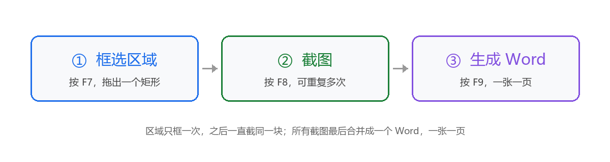
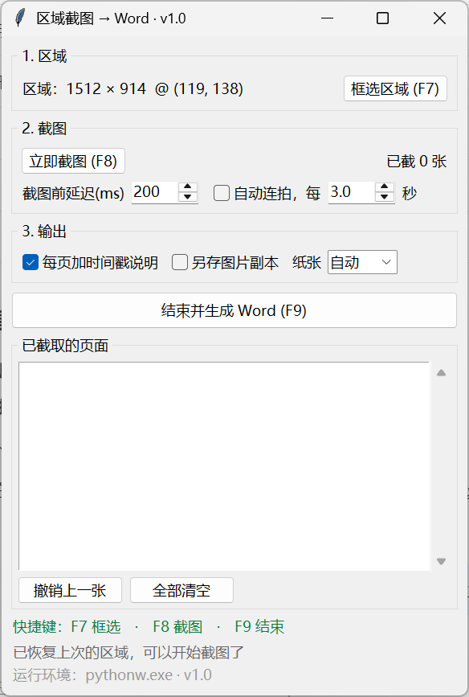

# 区域截图 → Word

在桌面上**框一次固定区域**，之后每按一次键截一张，最后一次性导出成 Word——**一张截图一页**。

适合盯一个固定窗口 / 表格 / 监控面板，隔一段时间记一张，最后交付一份按时间排列的截图文档。



---

## 三步上手

| | 做什么 | 会看到什么 |
|---|---|---|
| **①** | 按 **F7**，在屏幕上拖出一个矩形 | 屏幕变暗，拖完恢复，窗口显示"区域：1520 × 900 @ (100, 200)" |
| **②** | 按 **F8**，想截几张截几张 | 列表里多一行：`#01  16:20:31  1520 × 900` |
| **③** | 按 **F9**，选保存位置 | 选完自动生成 Word 并打开，一图一页 |

**区域只框一次**，之后一直截同一块。区域和选项会记在 `%APPDATA%\RegionShotToDocx\settings.json`，下次打开直接沿用。

> 三个键都是**全局热键**——你可以一直在目标窗口上操作，不用切回来点按钮。

## 界面



## 快速开始

**要求**：Windows 10/11 + Python 3.9+

```bash
git clone https://github.com/leejiaw/region-shot-to-docx.git
cd region-shot-to-docx
pip install -r requirements.txt
```

然后**双击 `run.bat`**（中文名 `启动.bat` 效果相同），或者：

```bat
pythonw region_shot_to_docx.pyw
```

程序启动后会自己检查依赖，缺包会告诉你怎么装。

> 不想装 Python？让别人打包成 exe 也行，但本仓库目前只提供源码运行方式。

## 第一次使用

1. **启动**：双击 `run.bat`，出现一个窗口，标题带版本号（如 `· v1.0`）。
2. **框选**：按 `F7`，屏幕变暗 → 按住左键拖出一个矩形 → 松开。拖太小（<8px）会自动取消。
3. **确认区域**：窗口第一行会显示 `区域：宽 × 高 @ (x, y)`。想换就再按一次 `F7`。
4. **截图**：按 `F8`。如果工具窗口正好压在选区上，它会先自动隐藏再截。
5. **重复**：继续按 `F8`，每按一次多一页。
6. **生成**：按 `F9` → 选保存位置 → 生成后自动用 Word 打开。
7. **检查**：每页一张图，图下一行小字是时间和尺寸；不满意可以关掉 Word、删掉文件重来（截图还在，除非你点了"全部清空"）。

## 功能

- **框一次，一直用**：区域固定，截图不再需要重新框选
- **全局热键**：F7 / F8 / F9，被占用时自动退到 `Ctrl+Alt+1 / 2 / 3`
- **自动连拍**：设定间隔自动截图，适合盯长任务
- **一图一页**：自动分页，横图用横向 A4、竖图用纵向 A4，等比缩放到版心
- **可选图注**：每页记录时间与像素尺寸
- **保留原图**：可勾选在 docx 旁生成 `xxx_图片/`
- **纯本地**：不联网、不上传、无遥测

## 快捷键

| 键 | 作用 | 被占用时的备用键 |
|---|---|---|
| **F7** | 重新框选区域 | `Ctrl+Alt+1` |
| **F8** | 立即截图 | `Ctrl+Alt+2` |
| **F9** | 结束并生成 Word | `Ctrl+Alt+3` |
| **Esc** | 框选时取消 | — |

窗口里绿色的那行会显示**当前实际生效的按键**。

## 选项

| 选项 | 默认 | 说明 |
|---|---|---|
| 截图前延迟 | 200 ms | 等动画 / 悬停效果稳定 |
| 自动连拍 | 关 | 每隔 N 秒自动截一张 |
| 每页加时间戳 | 开 | 图下一行小字：`#03  2026-10-26 16:20:31 · 1200 × 800` |
| 另存图片副本 | 关 | 在 docx 旁生成 `xxx_图片/` 保存原始 PNG |
| 纸张 | 自动 | 按第一张图的宽高比选横版 / 竖版，也可强制 |

## 输出

- A4，页边距 1.5 cm，图片等比缩放到版心内
- 一张截图一页，第一页不分页
- 图注预留了高度，不会出现"图把图注挤到下一页"的空白页
- 纸张方向按第一张截图的比例自动决定

## 常见问题

**双击后黑框一闪就没了？**
启动脚本里不能放中文（cmd 按 GBK 解析 UTF-8 会乱码），本项目已改成纯 ASCII。若仍有问题，在命令行里跑 `pythonw region_shot_to_docx.pyw` 看报错。

**报 `No module named 'PIL'`？**
当前 Python 没装 pillow。`pip install -r requirements.txt`，或换一个装好依赖的 Python。

**截图是黑的？**
部分硬件加速窗口（全屏游戏、某些播放器）用 GDI 抓不到。把窗口切成非全屏，或关闭硬件加速。

**多显示器 / 150% 缩放会错位吗？**
已做 per-monitor DPI 感知，坐标用物理像素。**不同显示器用不同缩放比例**时跨屏框选可能有偏差，建议在同一块屏内框。

**F7/F8/F9 没反应？**
被别的软件占了。看窗口里绿色的那行，会显示实际生效的按键。

**生成的 Word 打开是空白？**
说明图片没写进去。检查是否点过"全部清空"，或截图时选区被最小化（选区在屏幕外会提示重新框选）。

**想要更"满"的页面？**
页面比例跟着截图区域走。把框选区域调成接近 4:3 或 16:9，页面留白会更少。

## 实现说明

| 部分 | 用法 |
|---|---|
| 选区域 | tkinter 全屏半透明 `Toplevel` + 画布拖拽 |
| 抓屏 | `PIL.ImageGrab.grab(bbox=..., all_screens=True)` |
| 热键 | `ctypes` 调 `RegisterHotKey`，独立线程跑消息循环 |
| DPI | `SetProcessDpiAwareness(2)`，Tk 与 Win32 坐标对齐 |
| 文档 | `python-docx`，按页面版心等比缩放图片 |
| 依赖自举 | 启动时检查依赖，缺包则尝试换一个已装好的 Python 重开自己 |

全部代码在 `region_shot_to_docx.pyw` 一个文件里，约 1000 行，无框架依赖。

## 目录结构

```
region-shot-to-docx/
├── region_shot_to_docx.pyw   # 主程序
├── run.bat                   # 启动脚本（纯 ASCII）
├── 启动.bat                  # 中文入口，等价于 run.bat
├── requirements.txt
├── docs/
│   ├── flow.png              # 三步操作图
│   └── screenshot.png        # 界面截图
├── LICENSE
└── README.md
```

## 已知限制

- 仅 Windows（依赖 `RegisterHotKey`、`ImageGrab` 的 Win32 实现）
- 抓不到硬件加速的独占全屏画面
- 不同 DPI 的多显示器之间跨屏框选可能有偏移
- 截图临时放在 `%TEMP%`，生成后清理；中途崩溃会残留

## License

[MIT](LICENSE)

---

## English

**Region Shot to Docx** — pick a fixed screen region once, press **F8** whenever you want a shot, press **F9** to export a Word document with **one screenshot per page**.

Three steps: **F7** select region → **F8** capture (repeat) → **F9** export.

- Windows 10/11, Python 3.9+, `pillow` + `python-docx`
- `pip install -r requirements.txt`, then double-click `run.bat`
- Global hotkeys fall back to `Ctrl+Alt+1/2/3` when F7–F9 are taken
- Optional auto-capture interval, timestamp captions, PNG copies
- Everything runs locally: no network, no telemetry

MIT licensed.
